# Djibble — Case Study

Local **real-world activity** discovery — find what’s happening nearby, create your own hangouts, join groups, and chat with participants. Tagline: **Gets you out!**

> Portfolio case study: screenshots + architecture + stack. Application source is private.

---

## Public links

### Web
- App: [app.djibble.com](https://app.djibble.com)

### Mobile app
- Android: [Google Play — Djibble](https://play.google.com/store/apps/details?id=com.djibble.app)
- iOS: [App Store — Djibble](https://apps.apple.com/app/djibble/id1450509374)

---

## My responsibilities

I owned **everything except the mobile app** on this product:

- Backend / API development (Laravel)
- Admin panel & CMS
- Web frontend
- Realtime chat server (Node / Socket.IO)
- Integrations (auth, media/storage, push-related backend, monitoring)
- Deployment, server setup, and ongoing release / ops work

The **mobile app** was handled separately (not my build). I still integrated and supported it via the shared API and chat services.

### Want proof?

Source is private (client NDA). If you want to verify the work, **book a short meeting** — I can walk through the private codebase live (architecture, key modules, deploys) on a screen share.

---

## Why this is useful

People want spontaneous, place-based plans — sports, nightlife, food, wellness — without scrolling a feed of strangers online. Djibble connects **nearby activities** with capacity, location, meeting points, and group chat so organizers and joiners can coordinate in the real world.

Ops need an admin surface to manage users, activities, categories, support tickets, CMS pages, and media — with RBAC and exports.

---

## Product surfaces

| Surface | Role |
|---------|------|
| **Mobile app** | Primary UX — discover, join/create activities, chat, profile |
| **Next.js web app** | Browser discovery — search by city/date, activity detail, create flow, upcoming, chat |
| **Laravel API + admin** | REST API, Sanctum auth, CMS, RBAC, tickets, file manager |
| **Node Socket.IO chat** | Realtime activity-group messaging |
| **Marketing site** | Public landing / SEO (WordPress) |

---

## Screenshots

### Mobile app

Play Store / product captures — discovery, activity cards, join flow, and chat entry points.

<p align="center">
  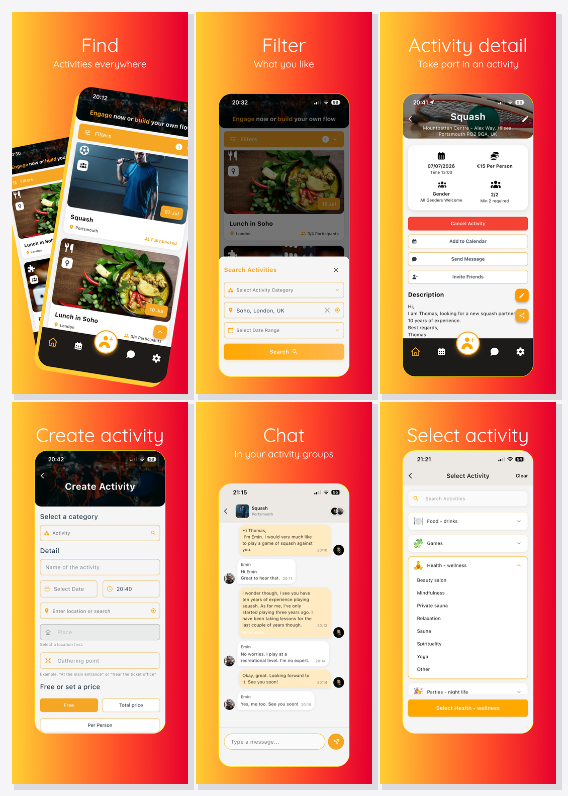
</p>

<p align="center">
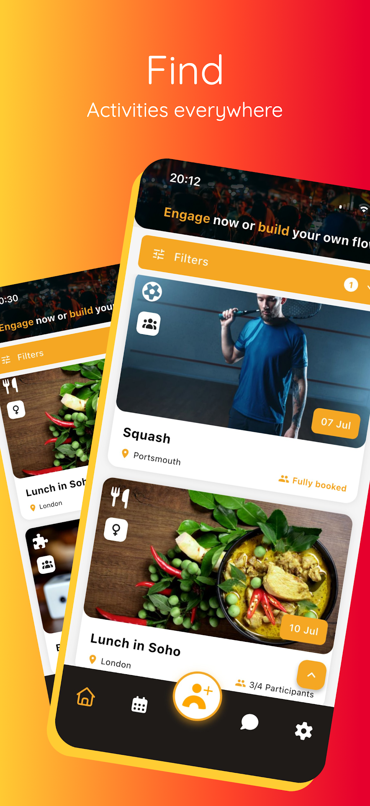
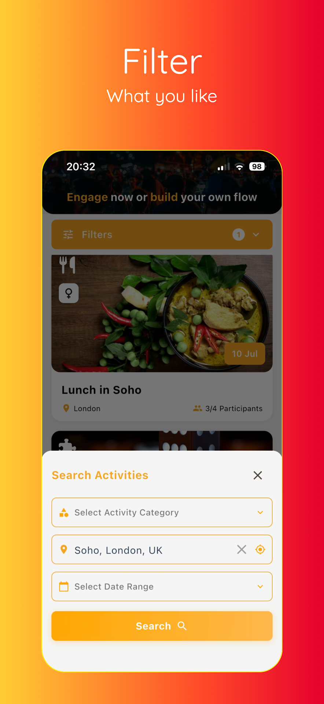
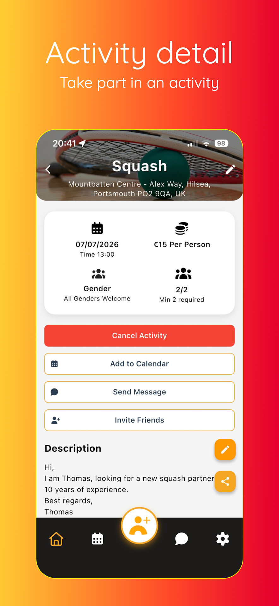
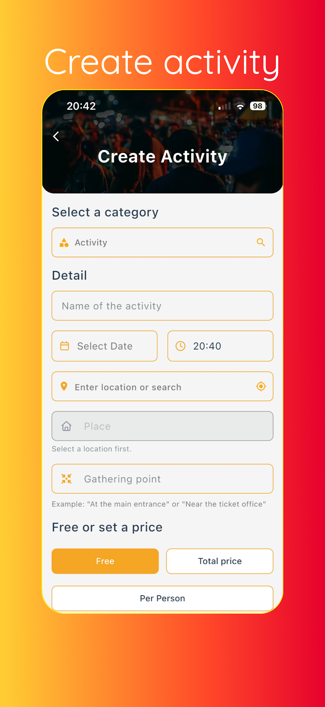
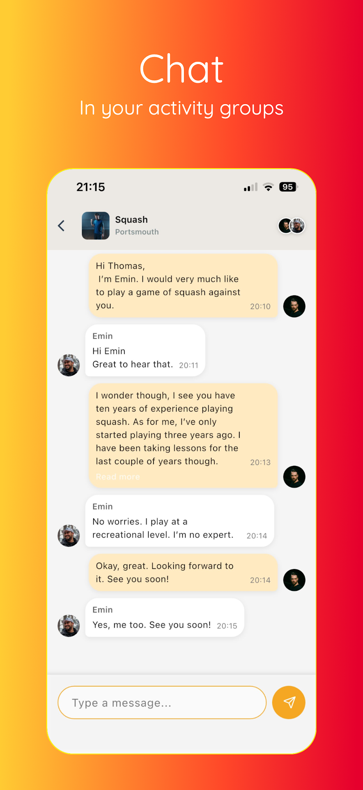
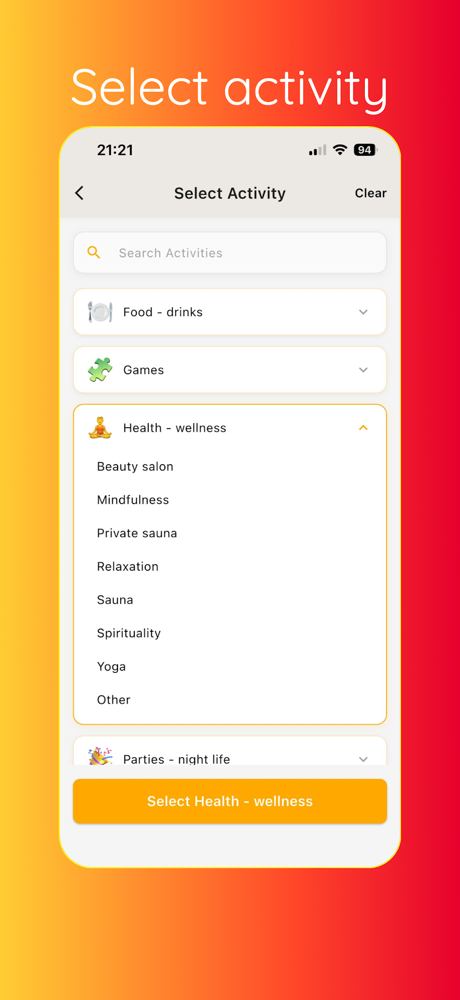
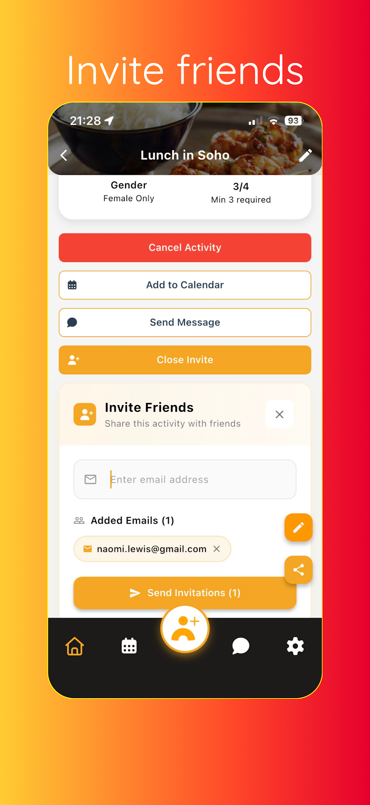
</p>

### Web app

Browse activities, create flow, group chat, upcoming list, and activity detail (map, participants, join/invite).

<p align="center">
  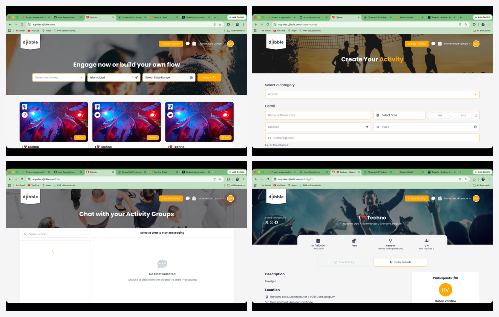
</p>

**Home / search**

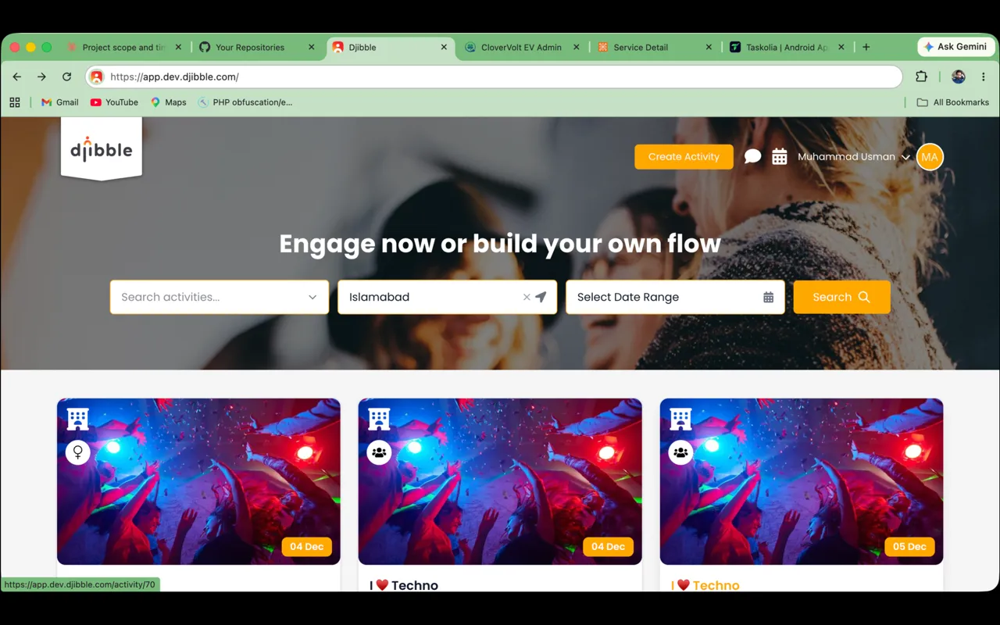

**Browse activities**

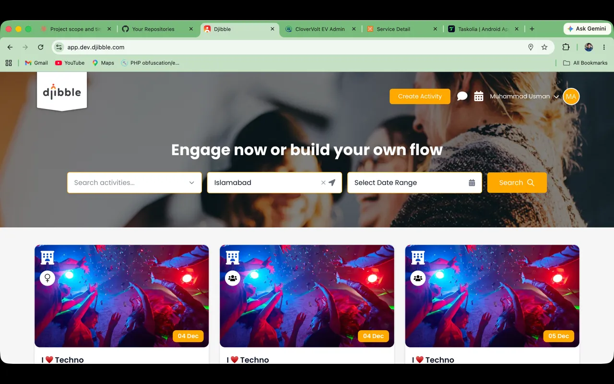

**Create activity**

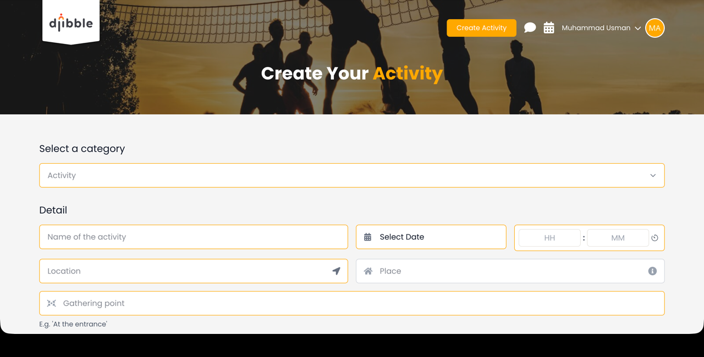

**Chat**

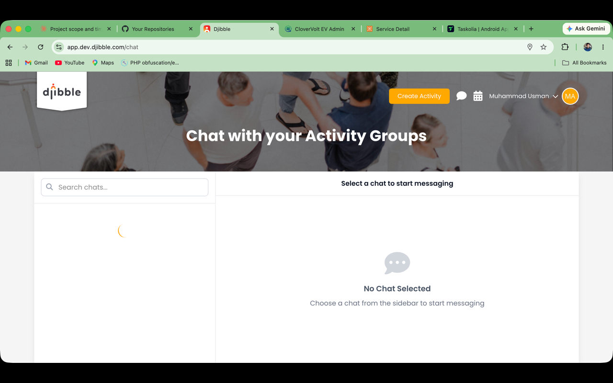

**Upcoming activities**

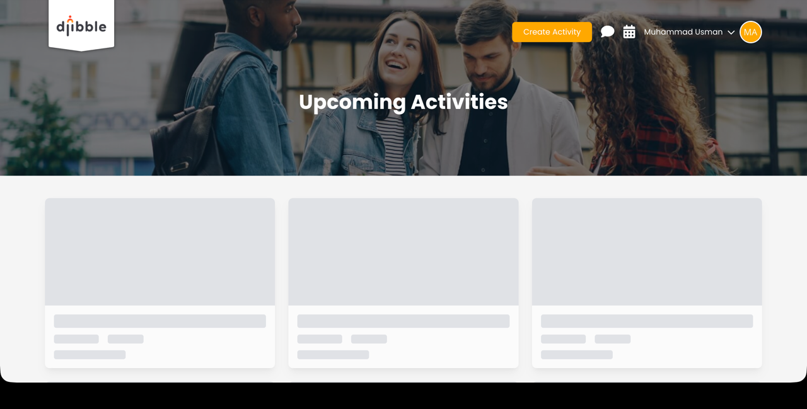

**Activity detail**

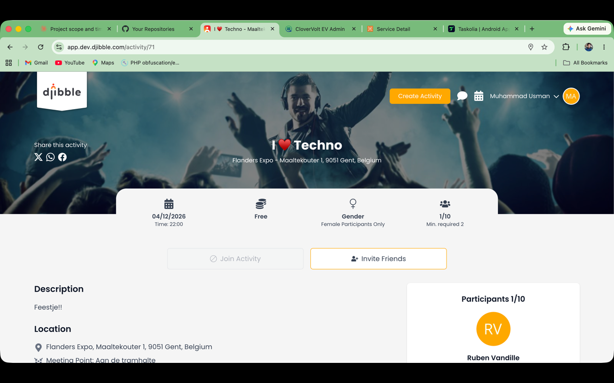

---

## Core features

### Discovery & activities
- Search by keyword, **city / location**, and date range
- Activity cards with capacity, gender rules, price, venue, and date badges
- Activity detail: description, meeting point, Google Maps, participants, share links
- Create activity wizard; upcoming activities list
- Category browse (sport, nightlife, food, wellness, …)

### Social & realtime
- Activity-group **chat** via Socket.IO
- Invite friends; participant counters / min required
- Push-ready stack (Firebase / FCM on backend)

### Auth & platform
- Email/password + **social login** (Laravel Socialite)
- Sanctum API tokens for web / mobile clients
- Multi-language CMS pages (FAQ, terms, about)
- Support tickets (feedback / questions / complaints)

### Admin / CMS
- Dashboard stats + charts + PDF export
- Users / unverified users / clients
- Activities, categories & subcategories
- Support tickets, FAQ, static pages, header images, social links
- Laravel File Manager + S3 / MinIO media
- Roles & permissions (Spatie)
- Shift management for ops staff

---

## Deployment

Backend ships with a **Docker** stack (Laravel app, MariaDB, MinIO for S3-compatible media) plus traditional VPS install docs (Composer, queue worker, Socket.IO chat service). Media lives on **AWS S3** or MinIO; errors are tracked with **Sentry** on API, Next.js, and the chat Node service.

Secrets and hostnames stay off this case-study repo.

---

## Tech stack

| Layer | Technology |
|-------|------------|
| Mobile | Native / store apps (`com.djibble.app`) |
| Public web | **Next.js 15** + **React 19** + **Tailwind CSS 4** + NextAuth |
| Realtime client | **socket.io-client** |
| Backend API | **Laravel 12** + **Sanctum** + Socialite |
| Admin | Laravel UI + RBAC (**Spatie Permission**) + File Manager |
| Chat server | **Node.js** + **Express** + **Socket.IO** |
| Media | **AWS S3** / MinIO (Flysystem) |
| Observability | **Sentry** (Laravel, Next.js, Node) |
| Push / messaging | **Firebase** (kreait/laravel-firebase) |
| Infra | Docker Compose option; nginx / Ubuntu traditional |

---

## Architecture

```
Mobile app  ──┐
              ├──► Laravel 12 API  (Sanctum)  ──► MySQL
Next.js web ──┘         │
                        ├──► S3 / MinIO (media)
                        ├──► Firebase (push)
                        └──► Socket.IO chat server  ◄── web/mobile clients
Admin panel  ──────────► same Laravel app (session + RBAC)

Marketing (WordPress) ──► public landing / SEO
```

---

## Notes

- Case study only — no application source or secrets in this repo.
- Internal admin / chat / API hostnames intentionally omitted from public links.
